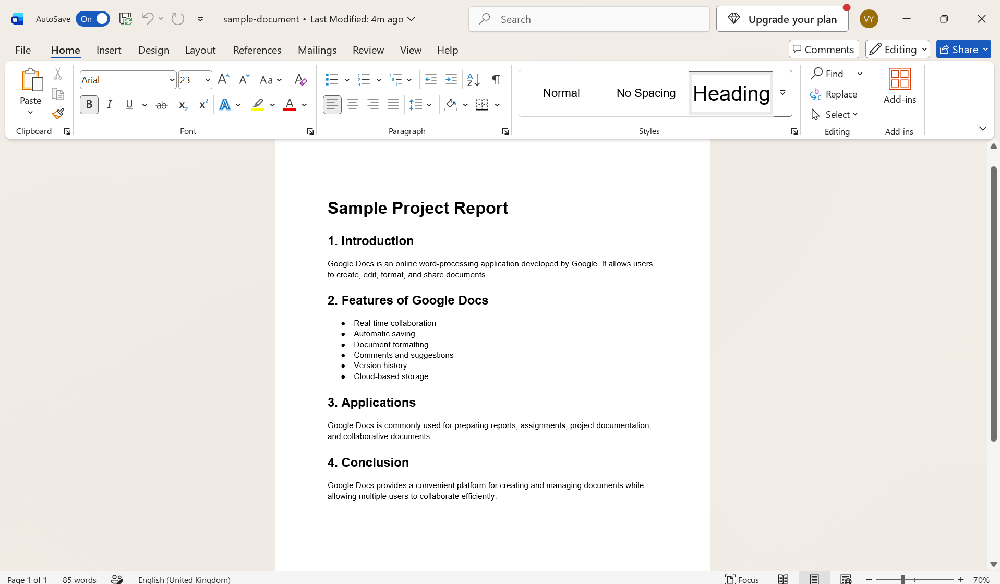

# Google Docs Documentation

## 1. Introduction

Google Docs is a free, web-based word-processing application developed by Google. It allows users to create, edit, format, and share documents online.

## 2. Key Features

- **Real-Time Collaboration:** Multiple users can work on the same document.
- **Automatic Saving:** Changes are automatically saved to Google Drive.
- **Formatting:** Provides tools for text formatting, headings, tables, and lists.
- **Comments and Suggestions:** Allows users to review and suggest changes.
- **Version History:** Tracks previous versions of a document.
- **Cloud Storage:** Documents can be accessed from different devices.

## 3. Creating a Document

1. Open Google Docs.
2. Create a blank document.
3. Enter the required content.
4. Apply formatting using the toolbar.
5. Rename the document.
6. The document is automatically saved.

## 4. Downloading and Exporting

Google Docs supports downloading documents in different formats, including:

- Microsoft Word (.docx)
- PDF (.pdf)
- Plain Text (.txt)
- Rich Text Format (.rtf)

## 5. Example Project

A sample project report created using Google Docs is included in the examples folder.

**Project location:** `examples/sample-document/`

The document demonstrates headings, formatting, and structured content.

## 6. Applications

- Preparing academic assignments.
- Creating project reports.
- Writing professional documents.
- Collaborative editing.
- Sharing documents online.

## 7. Conclusion

Google Docs provides an efficient platform for creating, editing, formatting, and sharing documents. Its collaboration and automatic saving features make it useful for both academic and professional work.

## 8. Output Screenshot

The following screenshot shows the sample document created using Google Docs.

