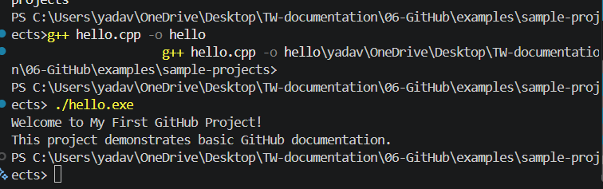

# GitHub Documentation

## 1. Introduction

GitHub is a web-based platform used for hosting, managing, and collaborating on software development projects. It uses Git for version control and allows developers to store and share their code repositories.

## 2. Key Features

- **Repositories:** Store and manage project files.
- **Branches:** Work on different versions of a project.
- **Commits:** Track changes made to files.
- **Pull Requests:** Propose and review changes.
- **Issues:** Report bugs and track tasks.
- **Collaboration:** Work with multiple developers.

## 3. Repository Management

GitHub repositories can contain source code, documentation, images, and other project files.

Common operations include:

- Creating repositories.
- Uploading and managing files.
- Cloning repositories.
- Pushing and pulling changes.
- Managing branches.

## 4. Example Project

A sample C++ project is included in the examples folder.

**Project location:** `examples/sample-projects/`

The project contains a simple C++ program that displays a greeting message.

## 5. Output

The program produces the following output:

```text
Hello, GitHub!
This is my sample C++ project.
```

## 6. Applications

- Software development and version control.
- Open-source project hosting.
- Team collaboration.
- Project documentation.
- Code sharing and portfolio development.

## 7. Conclusion

GitHub provides an effective platform for managing software projects, tracking changes, and collaborating with other developers.

## 6. Output Screenshot

The following screenshot shows the execution of the sample C++ project.

